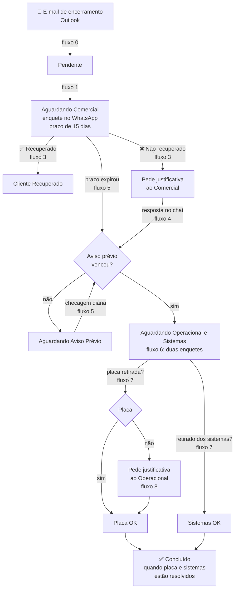

# Customer Closing Automation — Encerramento de contratos com Outlook, Microsoft Lists e WhatsApp

Automação em [n8n](https://n8n.io), dividida em 11 fluxos, que conduz o **encerramento de contrato de um cliente** do começo ao fim: recebe a solicitação por e-mail, registra no **Microsoft Lists (SharePoint)**, dá ao time **Comercial** um prazo para tentar recuperar o cliente e, se ele não for recuperado, aciona o **Operacional** (retirada da placa) e o time de **Sistemas** (remoção do cliente dos sistemas). Cada etapa é perguntada e respondida por **enquetes no WhatsApp**.


## O problema

Quando um cliente pedia o encerramento do contrato, o processo passava por várias áreas: o Comercial precisava tentar reverter, o Operacional tinha que retirar a placa da residência e o time de Sistemas precisava tirar o cliente de todas as plataformas. Tudo era combinado por e-mail e mensagem, sem um registro central. Era difícil saber em que pé estava cada cliente, prazos passavam e etapas ficavam esquecidas.

## Como funciona

A lista **Encerramento de Contrato** no Microsoft Lists é a fonte da verdade: cada cliente é um item, e a coluna `Processamento` diz em que etapa ele está. Os fluxos leem e atualizam essa lista, e as equipes respondem pelo WhatsApp **ou** direto no Lists.



### Os fluxos

| # | Fluxo | Gatilho | O que faz |
|---|-------|---------|-----------|
| 0 | Receber Solicitação de Encerramento por E-mail | Outlook (novo e-mail) | Filtra e-mails com "Encerramento" no assunto, extrai do corpo nome, endereço, telefone, e-mail, motivo e data do encerramento e cria o item no Lists. Se faltar algum campo, o item não é criado. |
| 1 | Encerramento de Clientes | A cada 30 s | Pega itens `Pendente`, abre o prazo comercial de 15 dias e envia ao grupo do Comercial uma enquete: *o cliente foi recuperado?* |
| 2 | Lembrete de Prazo para Recuperação de Cliente | Segunda, 8h | Envia ao Comercial um resumo com os clientes ainda dentro do prazo e quantos dias faltam. |
| 3 | Webhook de Mensagem do Comercial | Webhook (voto na enquete) | Recuperado → encerra o processo. Não recuperado → pede a justificativa no chat. |
| 4 | Receber Justificativa Comercial | Webhook (mensagem) | Grava a justificativa e decide: se o aviso prévio já venceu, segue para o Operacional; se não, aguarda. |
| 5 | Controle de Prazos | Diário, 8h | Marca como `Prazo Expirado` quem passou dos 15 dias sem resposta e libera para o Operacional os clientes cujo aviso prévio venceu. |
| 6 | Enviar Encerramento ao Operacional | Sub-fluxo | Envia duas enquetes em paralelo: retirada da placa (coordenador operacional) e retirada dos sistemas (time de Sistemas). |
| 7 | Webhook de Resposta do Operacional | Webhook (voto na enquete) | Registra placa retirada/não retirada e sistemas retirados. Quando as duas frentes terminam, marca `Concluído`. |
| 8 | Receber Justificativa Operacional | Webhook (mensagem) | Grava o motivo da placa não ter sido retirada e conclui o encerramento se os sistemas já estiverem resolvidos. |
| 9 | Lembrete Operacional e Sistemas | Segunda, 8h | Cobra semanalmente as pendências de placa e de sistemas. |
| 10 | Sincronizar Alterações do Lists | A cada 30 s | Detecta respostas preenchidas à mão no Lists e as reenvia para os webhooks 3, 4, 7 e 8, como se tivessem vindo do WhatsApp. |

### Exemplo de enquete

```text
🚨 ENCERRAMENTO DE CONTRATO

👤 Nome: Maria Exemplo
📍 Endereço: Rua Exemplo, 123
📝 Motivo: Mudança de endereço
📧 E-mail: maria@exemplo.com
📞 Telefone: (11) 99999-9999
📅 Aviso Prévio: 30/11/2026

O cliente foi recuperado?
  ○ ✅ Cliente Recuperado
  ○ ❌ Cliente Não Recuperado
```

## Decisões de projeto

- **Microsoft Lists como fonte da verdade:** todo o estado do processo fica numa lista que qualquer gestor consegue abrir, filtrar e auditar, sem depender do n8n.
- **Redis liga a enquete ao cliente:** quando uma enquete é enviada, o ID da mensagem fica guardado no Redis (`encerramento:poll:<id>`, `encerramento:operacional:<id>`, `encerramento:sistemas:<id>`) apontando para o item do Lists. O voto que chega pelo webhook é associado ao cliente certo, e a chave é apagada depois da resposta, o que evita processar o mesmo voto duas vezes.
- **Responder pelo WhatsApp ou pelo Lists:** o fluxo 10 transforma uma edição manual no Lists num evento igual ao do WhatsApp e o envia para o mesmo webhook. Assim existe um único caminho de processamento, seja qual for a origem da resposta. Essas chamadas internas levam um header com um segredo compartilhado, para os webhooks aceitarem o `itemId` informado só quando vem do próprio n8n.
- **Justificativa sem precisar citar o cliente:** quando a justificativa chega por mensagem livre no WhatsApp, ela é atribuída ao pendente mais antigo daquela área. Pelo Lists, o item vai explícito.
- **Prazos que andam sozinhos:** o Comercial tem 15 dias. Se não responder, o fluxo 5 encerra a tentativa e o processo segue sem depender de ninguém lembrar.
- **Operacional e Sistemas em paralelo:** as duas frentes recebem a enquete ao mesmo tempo e o encerramento só é concluído quando ambas estão resolvidas, não importa a ordem.
- **Lembretes semanais:** pendências do Comercial, do Operacional e de Sistemas são cobradas toda segunda-feira até serem resolvidas.

## Como usar

### Pré-requisitos

- n8n (self-hosted)
- [WAHA](https://waha.devlike.pro) (WhatsApp HTTP API) com uma sessão conectada e webhooks apontando para o n8n
- Redis
- Conta Microsoft 365 com Outlook e um site do SharePoint
- Uma lista no Microsoft Lists com as colunas usadas pelos fluxos: `Title` (endereço), `NomedoCliente`, `ContatodoCliente`, `E-MaildoCliente`, `Motivo`, `AvisoPrevio`, `Processamento`, `StatusComercial`, `ClienteRecuperado`, `DataInicioComercial`, `DataLimiteComercial`, `DataRespostaComercial`, `ObservaçãoComercial`, `StatusOperacional`, `PlacaRemovida`, `ObservaçãoOperacional`, `RetiradodoFindMe?`, `PollKeyComercial`, `PollKeyOperacional` e `PollKeySistemas`

### Passos

1. No n8n: **Workflows → Import from File** e importe os 11 arquivos de `workflows/`.
2. Crie as credenciais e associe-as aos nós marcados com `<<CRIAR CREDENCIAL ...>>`: Microsoft Outlook OAuth2, Microsoft SharePoint OAuth2 e Redis.
3. Em todos os nós do SharePoint, selecione o seu **site** e a sua **lista** (os IDs foram trocados por `<<PREENCHER>>`, mas os nomes originais ficaram como referência).
4. Nos nós HTTP que enviam mensagens:
   - troque `http://127.0.0.1:3000` pelo endereço da sua instância do WAHA;
   - ajuste `session` e preencha cada `chatId` com o grupo da área correspondente (Comercial, Operacional ou Sistemas), no formato `...@g.us`.
5. Nos fluxos **4** e **8**, troque `5511999999999` pelo número do grupo/remetente que pode enviar justificativas.
6. Nos fluxos **4**, **8** e **10**, defina o mesmo segredo no lugar de `<<PREENCHER>>` do header `x-aster-sync`.
7. Nos fluxos **4** e **5**, reaponte os nós **Call 'Enviar Encerramento ao Operacional'** para o fluxo 6 importado.
8. No fluxo **10**, ajuste `BASE` para a URL de webhooks do seu n8n.
9. No WAHA, configure os webhooks de voto em enquete (`poll.vote`) e de mensagem para os paths `Resposta-Enquete-Comercial`, `Observacao-Comercial`, `Resposta-Operacional` e `Observacao-Operacional`.
10. Ative os fluxos.

## Segurança

Os fluxos publicados aqui não têm credenciais, chaves, segredos, endereços internos, IDs do tenant Microsoft, IDs de grupos nem dados reais de clientes. Todos os valores sensíveis foram substituídos por marcadores (`<<PREENCHER>>`).
